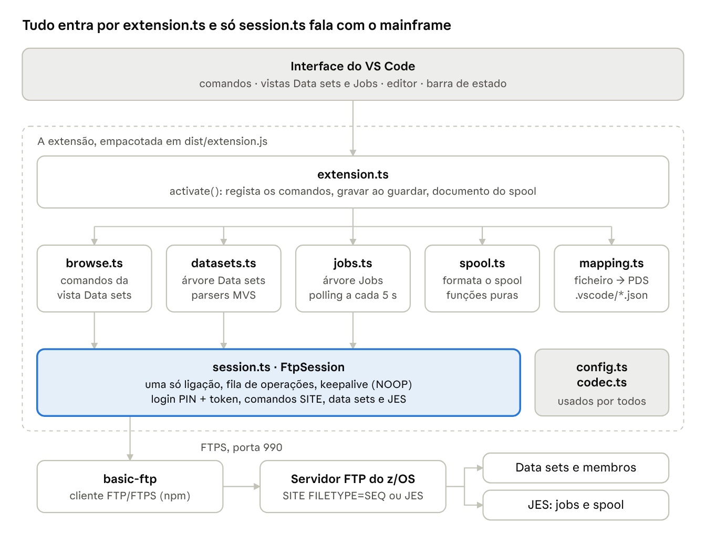

# Mainframe FTPS – Guia do developer

Atualizado a 17/11/2026 · versão 0.3.2

## 1. Introdução

O **Mainframe FTPS** é uma extensão do VS Code que deixa escrever JCL, Easytrieve e COBOL no editor e gravar, submeter e acompanhar esse código num mainframe IBM z/OS. Toda a comunicação passa por **FTPS** (FTP com TLS), a mesma ligação que o servidor FTP do z/OS já disponibiliza. Não é preciso instalar nada no mainframe.

Este guia é para quem vai mexer no código pela primeira vez. Não assume que conheces o mainframe nem a API de extensões do VS Code. No fim deves saber compilar, correr e depurar a extensão, perceber o papel de cada ficheiro e acrescentar uma funcionalidade simples.

| Item                         | Valor                                                                              |
| ---------------------------- | ---------------------------------------------------------------------------------- |
| Versão descrita              | 0.3.2                                                                              |
| Linguagem                    | TypeScript (cerca de 2600 linhas em `src/`)                                        |
| Repositório                  | [github.com/jmgvieira/mainframe-ftps](https://github.com/jmgvieira/mainframe-ftps) |
| Marketplace                  | `JorgeMiguel.mainframe-ftps`                                                       |
| Única dependência em runtime | [basic-ftp](https://github.com/patrickjuchli/basic-ftp)                            |
| VS Code mínimo               | 1.85                                                                               |

O código de referência é o do GitHub. Para fazer commits, trabalha sempre a partir de um clone do repositório.

## 2. O mínimo que precisas de saber sobre o mainframe

O z/OS não tem pastas e ficheiros como o Windows. Tem **data sets**, e a extensão traduz entre os dois mundos. Estes são os termos que aparecem no código:

| Termo                     | O que é                                                                                                     | Exemplo                  |
| ------------------------- | ----------------------------------------------------------------------------------------------------------- | ------------------------ |
| Data set                  | Um "ficheiro" do mainframe. O nome tem até 44 caracteres, em qualificadores de 1 a 8 separados por pontos.  | `U12345.JCL.LIB`         |
| PDS / PDSE                | Data set particionado (DSORG=PO): funciona como uma pasta com membros. PDSE é a versão moderna.             | `U12345.JCL.LIB`         |
| Membro                    | Um "ficheiro" dentro de um PDS, com nome de 1 a 8 caracteres.                                               | `U12345.JCL.LIB(MEUJOB)` |
| Sequencial (PS)           | Data set simples, sem membros.                                                                              | `U12345.DADOS.TXT`       |
| LRECL / RECFM             | Comprimento do registo e formato. O JCL usa normalmente FB 80: linhas de 80 colunas, com espaços à direita. | `RECFM=FB LRECL=80`      |
| JCL                       | Linguagem que descreve um *job* (um trabalho em lote) e os seus *steps*.                                    | `//MEUJOB JOB ...`       |
| JES                       | Subsistema que recebe os jobs, executa-os e guarda o resultado.                                             | `JES2`                   |
| JOBID                     | Identificador que o JES dá a cada job submetido.                                                            | `JOB12345`               |
| Spool                     | O output do job: mensagens do sistema e os DD de saída (SYSOUT, SYSPRINT...).                               | `JESMSGLG`               |
| RC / ABEND                | Resultado de um step: código de retorno (0 = bem, 4 = aviso, 8 ou mais = erro) ou terminação anormal.       | `RC=0004`, `ABEND=S0C7`  |
| EBCDIC / código de página | O mainframe não usa ASCII. O IBM-1147 é o EBCDIC francês com €, usado aqui.                                 | `IBM-1147`               |
| RACF                      | Sistema de segurança. Várias passwords erradas seguidas **revogam o utilizador**.                           | —                        |
| HSM                       | Gestor que arquiva ("migra") data sets pouco usados. Antes de os abrir é preciso fazer *recall*.            | `Migrated`               |

**Como o FTP do z/OS se comporta.** O servidor tem dois modos, que se trocam com um comando `SITE`:

  - `SITE FILETYPE=SEQ` – modo normal: `STOR` grava um data set, `RETR` lê-o, `LIST` lista data sets ou membros.

  - `SITE FILETYPE=JES` – modo JES: `STOR` **submete** o JCL, `LIST` lista jobs, `RETR JOB12345.x` devolve o spool todo e `DELE JOB12345` faz purge.

Os nomes vão sempre entre plicas (`'U12345.JCL.LIB(X)'`). Sem plicas, o servidor junta-lhes o prefixo do utilizador. A função `quoteDsn()` em `session.ts` trata disso.

**Login com PIN + token.** A password é um PIN fixo seguido de um código de token que muda a cada minuto. Por isso a extensão nunca pode repetir o login sozinha: o token já não é válido, e cada falha conta para a revogação no RACF.

## 3. Como funciona uma extensão do VS Code

Uma extensão tem duas metades: o `package.json` *declara* o que a extensão oferece, e o código TypeScript *implementa* esses comportamentos. Se algo aparece no menu mas não faz nada, normalmente falta a metade do código, ou o contrário.

**A parte declarativa:** `package.json` **→** `contributes`

| Chave                       | Para que serve aqui                                                                                                         |
| --------------------------- | --------------------------------------------------------------------------------------------------------------------------- |
| `commands`                  | Os cerca de 30 comandos (`mainframeFtps.connect`, `mainframeFtps.submit`...) com o título e o ícone.                        |
| `menus`                     | Onde cada comando aparece: barra da vista, menu de contexto de um nó, título do editor, Explorador. O `when` decide quando. |
| `viewsContainers` + `views` | O ícone "Mainframe" na barra de atividades, com as vistas "Data sets" e "Jobs".                                             |
| `viewsWelcome`              | O texto e os botões que aparecem quando uma vista está vazia (por exemplo, "Ligar (PIN + token)").                          |
| `configuration`             | As definições `mainframeFtps.*` que o utilizador vê em Settings.                                                            |
| `keybindings`               | Ctrl+Alt+J para submeter e Ctrl+Alt+K para ver o estado de um job.                                                          |
| `languages` + `grammars`    | A linguagem `mfspool`, para colorir o spool.                                                                                |
| `colors`                    | As cores do indicador da barra de estado (verde e cinzento).                                                                |

Outros campos importantes: `main` aponta para `./dist/extension.js` (o ficheiro compilado), e `activationEvents: ["onStartupFinished"]` faz a extensão arrancar logo depois do VS Code.

**A parte de código: a API** `vscode`

  - `activate(context)` – função chamada uma vez quando a extensão arranca. É aí que se criam os objetos e se registam os comandos. Tudo o que for registado entra em `context.subscriptions`, para ser libertado quando a extensão desliga.

  - `vscode.commands.registerCommand(id, fn)` – liga um id do `package.json` a uma função. Aqui é sempre feito pelo helper `cmd()`, que trata os erros.

  - `TreeDataProvider` – classe que alimenta uma árvore numa vista. Implementa `getChildren()` (quais são os filhos de um nó) e `getTreeItem()` (como cada nó se mostra). Para pedir ao VS Code que redesenhe a árvore, dispara-se o evento `onDidChangeTreeData`.

  - `contextValue` – etiqueta que cada nó da árvore leva (`mfJob`, `mfDsPO`, `mfMember`...). Os `menus` do `package.json` usam-na em `viewItem == ...` para decidir que ações mostrar.

  - `setContext` – cria variáveis para os `when`. A extensão usa `mainframeFtps.connected` para mostrar "Ligar" ou "Desligar".

  - `TextDocumentContentProvider` – cria documentos virtuais só de leitura a partir de um esquema de URI. O spool abre como `mfspool:/JOB12345/MEUJOB.spool`.

  - Armazenamento: `context.secrets` (cofre do sistema, para o PIN), `globalState` (dados da extensão em todos os projetos) e `workspaceState` (dados só desta pasta, como a lista de jobs).

  - Interface: `showInputBox`, `showQuickPick`, `showInformationMessage`/`Warning`/`Error`, `withProgress`, `createStatusBarItem` e `createOutputChannel` (o log "Mainframe FTPS").

Documentação oficial: [Your First Extension](https://code.visualstudio.com/api/get-started/your-first-extension), [Contribution Points](https://code.visualstudio.com/api/references/contribution-points) e [Tree View API](https://code.visualstudio.com/api/extension-guides/tree-view).

## 4. Preparar o ambiente

Só precisas de três programas. Todos os outros (TypeScript, esbuild, vsce) são instalados pelo `npm` dentro do projeto.

1.  **Node.js 18 ou mais recente** (recomendado: a versão LTS atual). Confirma com `node -v` e `npm -v`.

2.  **Git**. Confirma com `git --version`.

3.  **VS Code 1.85 ou mais recente.**

Depois, numa linha de comandos (PowerShell ou o terminal do VS Code):

```bash
git clone https://github.com/jmgvieira/mainframe-ftps.git
cd mainframe-ftps
npm ci
code .
```

O `npm ci` instala exatamente as versões do `package-lock.json` na pasta `node_modules/`. Usa `npm install` só quando quiseres acrescentar ou atualizar uma dependência, porque esse comando altera o `package-lock.json`.

| Pacote                         | Tipo    | Para que serve                                                            |
| ------------------------------ | ------- | ------------------------------------------------------------------------- |
| `basic-ftp`                    | runtime | Cliente FTP/FTPS. É a única biblioteca que vai dentro da extensão.        |
| `typescript`                   | dev     | Verifica os tipos (`tsc --noEmit`). Não gera ficheiros.                   |
| `esbuild`                      | dev     | Junta todo o código e o `basic-ftp` num só ficheiro, `dist/extension.js`. |
| `@vscode/vsce`                 | dev     | Cria o pacote `.vsix` e publica no Marketplace.                           |
| `@types/vscode`, `@types/node` | dev     | Tipos da API do VS Code e do Node, para o editor e o `tsc`.               |

O `@types/vscode` está fixo na 1.85.0, igual ao `engines.vscode`. Se o atualizares, tens de subir também o `engines.vscode`, e quem tiver um VS Code mais antigo deixa de conseguir instalar a extensão.

## 5. Compilar, correr e empacotar

Há dois scripts no `package.json`, e o segundo inclui o primeiro.

| Comando           | O que faz                                                                                                                                                                                                     | Resultado                             |
| ----------------- | ------------------------------------------------------------------------------------------------------------------------------------------------------------------------------------------------------------- | ------------------------------------- |
| `npm run compile` | 1\) `tsc --noEmit -p .` verifica os tipos e pára se houver erros; 2) `esbuild` junta `src/extension.ts` e as dependências num só ficheiro (o módulo `vscode` fica de fora, porque é o VS Code que o fornece). | `dist/extension.js` (cerca de 156 KB) |
| `npm run package` | Corre o `compile` e depois `vsce package --no-dependencies`.                                                                                                                                                  | `mainframe-ftps-<versão>.vsix`        |

**Porque é que há dois passos?** O esbuild é muito rápido mas não verifica tipos. O `tsc` verifica-os mas não gera nada (`--noEmit`). Juntos dão segurança e velocidade. O `--no-dependencies` diz ao vsce para não copiar a pasta `node_modules`, porque o `basic-ftp` já está dentro do bundle.

**O que vai para dentro do** `.vsix`**.** O ficheiro `.vscodeignore` exclui `src/**`, `node_modules/**`, `tsconfig.json`, `.vscode/**`, `*.vsix` e `.gitignore`. Ficam `dist/`, `package.json`, `README.md`, `CHANGELOG.md`, `LICENSE`, `icon.png`, `resources/` e `syntaxes/`. Para ver a lista exata: `npx vsce ls`.

### Correr em modo de desenvolvimento (F5)

O repositório ainda não tem a pasta `.vscode/`. Cria `.vscode/launch.json` com este conteúdo:

```json
{
  "version": "0.2.0",
  "configurations": [
    {
      "name": "Correr a extensão",
      "type": "extensionHost",
      "request": "launch",
      "args": ["--extensionDevelopmentPath=${workspaceFolder}"],
      "outFiles": ["${workspaceFolder}/dist/**/*.js"]
    }
  ]
}
```

1.  Corre `npm run compile`.

2.  Carrega em **F5**. Abre-se uma segunda janela, o *Extension Development Host*, com a tua versão da extensão carregada.

3.  Nessa janela, abre uma pasta de teste e configura `mainframeFtps.host` nas definições.

4.  Depois de alterares o código, volta a correr `npm run compile` e, na janela de teste, executa **Developer: Reload Window** (Ctrl+R).

Para os breakpoints funcionarem nos ficheiros `.ts`, o esbuild tem de gerar um *source map*. Acrescenta `--sourcemap` ao comando do esbuild no script `compile`. Se não quiseres que o mapa vá no `.vsix`, junta `dist/*.map` ao `.vscodeignore`.

### Instalar um `.vsix` à mão

No VS Code: Extensions → menu ⋯ → **Install from VSIX...**. Pela linha de comandos: `code --install-extension mainframe-ftps-0.3.1.vsix`.

## 6. Estrutura de pastas

O projeto é pequeno: 9 ficheiros TypeScript e alguns ficheiros de configuração.

```text
mainframe-ftps/
├─ src/                      código-fonte (TypeScript)
│  ├─ extension.ts           ponto de entrada: activate(), comandos, gravar ao guardar, spool
│  ├─ session.ts             a ligação FTPS: login, fila, keepalive, operações z/OS
│  ├─ browse.ts              comandos da vista Data sets (abrir, criar, renomear, apagar...)
│  ├─ datasets.ts            árvore Data sets + interpretação das listagens MVS
│  ├─ jobs.ts                árvore Jobs + polling do estado + interpretação das listagens JES
│  ├─ spool.ts               formatação do spool (resumo de steps, cabeçalhos por DD, ASA)
│  ├─ mapping.ts             associação ficheiro local → PDS(membro); validação de nomes
│  ├─ codec.ts               conversão de texto ISO-8859-15 / Latin-1 / UTF-8
│  └─ config.ts              leitura das definições mainframeFtps.*
├─ syntaxes/
│  └─ mfspool.tmLanguage.json   gramática TextMate que dá cores ao spool
├─ resources/
│  └─ mainframe.svg          ícone da barra de atividades
├─ release/                  .vsix publicados (no .gitignore: usar git add -f)
├─ dist/                     gerado pelo build (não vai para o Git)
├─ node_modules/             gerado pelo npm ci (não vai para o Git)
├─ package.json              manifesto da extensão + scripts + dependências
├─ package-lock.json         versões exatas das dependências
├─ tsconfig.json             opções do TypeScript (strict, ES2022, commonjs)
├─ .vscodeignore             o que fica fora do .vsix
├─ .gitignore                node_modules/, dist/, *.vsix
├─ README.md                 manual do utilizador (aparece no Marketplace)
├─ CHANGELOG.md              histórico de versões
├─ LICENSE                   MIT
└─ icon.png                  ícone do Marketplace
```

Na máquina do utilizador, a extensão também cria ficheiros dentro da pasta de trabalho aberta:

  - `.vscode/mainframe-ftps.json` – a associação entre ficheiros locais e destinos no mainframe (ver `mapping.ts`).

  - `mainframe/<PDS>/<MEMBRO>.<ext>` – cópias locais dos membros abertos a partir da vista Data sets (ver `browse.ts`).

## 7. Arquitetura

O código está em camadas: a interface do VS Code chama `extension.ts`, que distribui o trabalho pelos módulos de cada área. Todos os pedidos ao mainframe passam pela classe `FtpSession`, em `session.ts`.



módulos de src/ e o caminho até ao mainframe

As setas indicam "chama". `spool.ts` e `mapping.ts` não usam a sessão: o spool só formata texto já recebido, e o mapping só lê e escreve o JSON local. A regra mais importante da arquitetura é que **nenhum módulo usa o cliente FTP diretamente**: tudo passa por `session.run()`, que garante uma operação de cada vez.

## 8. Ficheiro a ficheiro

Lê os ficheiros por esta ordem: `config.ts` e `codec.ts` são curtos e independentes, `session.ts` é o coração e `extension.ts` liga tudo.

### `config.ts` (51 linhas)

Tem uma só função, `getConfig()`, que lê todas as definições `mainframeFtps.*` e devolve um objeto `MfConfig` com tipos e valores por omissão. Chama-se `getConfig()` sempre que for preciso, em vez de guardar o resultado: assim, uma definição alterada pelo utilizador vale logo na operação seguinte.

### `codec.ts` (73 linhas)

Converte texto em bytes para a transferência. O z/OS converte entre a codificação do PC e o EBCDIC do mainframe, mas o Node não traz ISO-8859-15 (Latin-9, com €). Como o Latin-9 só difere do Latin-1 em 8 posições (€ Š š Ž ž Œ œ Ÿ), a tabela está feita à mão.

  - `encode(text, enc)` / `decode(buf, enc)` – texto para bytes e o inverso. Um carácter que não existe na codificação vira `?`.

  - `unsupported(text, enc)` – lista os caracteres que não têm equivalente, para avisar o utilizador antes de gravar.

  - `zosName(enc)` – o nome que o z/OS espera no `SITE SBDATACONN` (por exemplo, `ISO8859-15`).

### `mapping.ts` (136 linhas)

Guarda para onde vai cada ficheiro local. A classe `TargetMap` escreve em `.vscode/mainframe-ftps.json`, com caminhos relativos à pasta de trabalho:

```json
{
  "lastPds": "U12345.JCL.LIB",
  "files": {
    "jobs/copia.jcl": "U12345.JCL.LIB(COPIA)",
    "rascunho.jcl": "IGNORE"
  }
}
```

O valor `IGNORE` significa "nunca gravar este ficheiro". Um ficheiro fora de qualquer pasta de trabalho fica no `globalState`. O ficheiro tem ainda funções pequenas e sem estado: `pdsOf()` e `memberOf()` partem `A.B(X)` em `A.B` e `X`; `validateDsn()` e `validateMember()` aplicam as regras de nomes do z/OS; `suggestMember()` propõe um nome de membro a partir do nome do ficheiro.

### `session.ts` (662 linhas) – o coração

A classe `FtpSession` é a única que fala com o mainframe. Tem três regras:

1.  **Uma só ligação.** `ensureConnected()` liga se for preciso. Se já houver uma ligação a abrir (`this.connecting`), espera por ela em vez de abrir outra.

2.  **Uma operação de cada vez.** O FTP não aceita dois comandos em simultâneo na mesma ligação. `enqueue()` encadeia as operações numa *promise* (`this.queue`), por isso cada uma só começa quando a anterior termina, mesmo que falhe.

3.  **Nunca repetir o login sozinha.** Um erro 530 (login recusado) apaga o PIN guardado e mostra o erro. Se a ligação cair a meio de uma operação, `run()` pergunta ao utilizador antes de voltar a ligar, e só repete a operação uma vez.

Como está organizada, de cima para baixo:

| Bloco     | Métodos                                                                                           | O que fazem                                                                                                                                |
| --------- | ------------------------------------------------------------------------------------------------- | ------------------------------------------------------------------------------------------------------------------------------------------ |
| Ligação   | `connect`, `askUser`, `askPassword`, `disconnect`                                                 | Pedem o utilizador e a password (PIN e token num só campo), fazem `client.access()` com TLS, enviam `SITE SBDATACONN` e os `siteCommands`. |
| Keepalive | `startKeepAlive`, `keepAliveTick`                                                                 | A cada 60 s mete um `NOOP` na fila. Deteta ligações fechadas pelo servidor e desliga por inatividade, se estiver configurado.              |
| Fila      | `enqueue`, `run`                                                                                  | Toda a operação pública passa por `run(label, op)`.                                                                                        |
| Data sets | `uploadText`, `downloadText`, `listDatasetsRaw`, `listMembersRaw`, `allocate`, `rename`, `remove` | `STOR`, `RETR`, `LIST`, `MKD`, `RNFR`/`RNTO` e `DELE` em modo `FILETYPE=SEQ`.                                                              |
| JES       | `submit`, `jesList`, `spoolWithList`, `deleteJob`                                                 | As mesmas operações em modo `FILETYPE=JES`. Voltam sempre a `SEQ` no `finally`.                                                            |
| Interface | `updateStatus`                                                                                    | O indicador na barra de estado e o contexto `mainframeFtps.connected`.                                                                     |

Detalhes que convém conhecer:

  - `jesById()` envia `SITE JESJOBNAME=*` e `SITE JESOWNER=<user>` antes de qualquer acesso por JOBID. Sem isto, jobs cujo nome não começa pelo userid davam "550 Jobid not found" (correção da 0.3.1).

  - `rawList()` usa um método interno do basic-ftp (`_requestListWithCommand`) para obter a listagem em texto bruto, porque o parser do basic-ftp não percebe o formato MVS. Se o basic-ftp mudar numa versão nova, é aqui que a extensão parte primeiro.

  - `client.ftp.encoding = "latin1"` porque as listagens chegam na codificação da ligação de dados, não em UTF-8.

  - `CancelledError` é lançado quando o utilizador fecha uma caixa de diálogo. O helper `cmd()` ignora-o, por isso nunca aparece como erro.

### `datasets.ts` (269 linhas)

A árvore da vista **Data sets**. Os nós são do tipo `MfNode`: `filter` → `ds` → `member`, mais `message` para textos como "PDS vazio". O `DatasetsProvider` guarda as listagens em cache (`dsCache`, `memberCache`) e só volta a pedi-las com "Atualizar". As funções `parseDatasetList()` e `parseMemberList()` interpretam o texto devolvido pelo `LIST` (os comentários no código mostram o formato esperado). `normalizeName()` troca `£`→`#` e `à`→`@`: no IBM-1147 os caracteres nacionais chegam trocados pela ligação de dados.

### `browse.ts` (418 linhas)

Os comandos da vista Data sets, registados por `registerBrowse()`: filtros, abrir, novo membro, novo data set (PDSE, PDS ou PS, ou "igual a este"), renomear, apagar, submeter e copiar nome. `localUri()` decide onde fica a cópia local (`mainframe/<PDS>/<MEMBRO>.<ext>`). `extFor()` escolhe a extensão pelos qualificadores do nome: `JCL`/`CNTL`/`PROC` dão `.jcl`, `EZT`/`EASY` dão `.ezt`, `COBOL` dá `.cbl`, `COPY` dá `.cpy`, e o resto dá `.txt`. `openRemote()` descarrega o membro, grava a cópia local, associa-a ao destino e abre-a, por isso o Ctrl+S seguinte já grava no sítio certo.

### `jobs.ts` (264 linhas)

A árvore da vista **Jobs**. `JobInfo` guarda o JOBID, o nome, o estado (`INPUT`, `ACTIVE`, `OUTPUT`...) e o resultado (`RC=0000`, `ABEND=S0C7`...). A lista fica no `workspaceState` (no máximo 30 jobs).

  - `add()` acrescenta um job e chama `startPolling()`, que consulta o JES a cada 5 s até o estado ser `OUTPUT` ou passarem 10 min. No fim, `notifyFinished()` mostra uma notificação com o botão "Ver spool".

  - `parseJobLine()` e `parseJobList()` interpretam a listagem JES (formato `JESINTERFACELEVEL=2`).

  - `severity()` classifica o resultado: `ok`, `warn` (RC até 4), `error` (RC acima de 4, ABEND, JCL error) ou `running`. Define o ícone e o tipo de notificação.

  - Um job terminado expande-se nos seus DD (`JobDd`). Clicar num DD abre o spool posicionado nesse DD.

### `spool.ts` (225 linhas)

Funções puras, sem `import vscode`, para poderem ser testadas à parte. Transformam o spool em bruto num documento ao estilo do SDSF:

  - `parseSpoolFiles()` lê a lista de DD do `LIST JOB12345`.

  - `splitSpool()` parte o `RETR JOB12345.x` pelos marcadores `!! END OF JES SPOOL FILE !!`, e `sections()` associa cada parte ao seu DD.

  - `stepResults()` tira o RC de cada step das mensagens `IEF142I`, `IEF450I` e `IEF272I`.

  - `stripAsa()` remove o carácter de controlo de impressão da coluna 1.

  - `formatSpool()` monta o documento final: um resumo com os steps e, a seguir, cada DD com um cabeçalho `=== DDNAME | STEP | #001 ===`.

  - `documentSections()` volta a encontrar esses cabeçalhos para o Outline, o breadcrumb e as zonas que se podem dobrar.

### `extension.ts` (522 linhas)

O ponto de entrada. Em `activate()` cria os objetos (`FtpSession`, `TargetMap`, `JobsProvider`, `DatasetsProvider`), regista o fornecedor do spool (`mfspool:`), o Outline e o dobrar do spool, o evento `onDidSaveTextDocument` e os comandos gerais. Os comandos da vista Data sets vêm de `registerBrowse()`. Outras funções importantes:

  - `onSave()` / `upload()` / `askTarget()` – gravar ao guardar (ver a secção 9).

  - `prepareText()` – converte o texto do editor em registos: expande tabs, avisa de linhas acima do LRECL e de caracteres sem equivalente, usa CRLF e codifica.

  - `openSpool()` – abre ou atualiza o separador do spool e posiciona no DD pedido.

  - `cmd()` – regista um comando com tratamento de erros comum: `CancelledError` é ignorado, os outros erros vão para o log e aparecem com o botão "Ver log". **Regista sempre comandos novos com** `cmd()`**.**

## 9. Os fluxos principais, passo a passo

Segue estes fluxos no código com breakpoints: é a forma mais rápida de perceber como as peças encaixam.

### Ligar (PIN + token)

1.  Qualquer operação chama `session.run()`, que chama `ensureConnected()`.

2.  Se não houver ligação, `connect()` verifica se o `host` está configurado, chama `askUser()` (usa `mainframeFtps.user` ou pergunta) e `askPassword()` (um campo só com o PIN e o token seguidos).

3.  `client.access()` abre o FTPS: `secure: true` é o modo explícito (AUTH TLS), `"implicit"` é o implícito.

4.  Após o login, envia `SITE SBDATACONN=(IBM-1147,ISO8859-15)` e os `siteCommands` configurados.

5.  Arranca o keepalive, o indicador fica verde e o evento `onDidChangeState(true)` faz a vista Jobs atualizar os jobs em curso.

6.  Se o login falhar com **530**, o PIN guardado é apagado e aparece um aviso sobre a revogação. Nada é repetido automaticamente.

### Gravar ao guardar (Ctrl+S)

1.  O VS Code dispara `onDidSaveTextDocument`, que chama `onSave(doc)` em `extension.ts`.

2.  Se `autoUploadOnSave` estiver desligado, ou o ficheiro não for local, termina.

3.  `targets.get(uri)` procura o destino em `.vscode/mainframe-ftps.json`. Se for `IGNORE`, termina.

4.  Se não houver destino e a extensão estiver em `fileExtensions` (`.jcl`, `.ezt`, `.cbl`, `.cpy`, `.proc`), pergunta "Gravar também no mainframe?". `askTarget()` pede o PDS e depois o membro, e guarda a resposta.

5.  `prepareText()` expande tabs, avisa de linhas com mais de 80 colunas e de caracteres sem equivalente, junta as linhas com CRLF e codifica em ISO-8859-15.

6.  `session.uploadText()` envia `TYPE A`, `SITE FILETYPE=SEQ` e `STOR 'PDS(MEMBRO)'`. O z/OS converte para EBCDIC.

7.  A barra de estado mostra "Gravado em ..." e a vista Data sets atualiza esse PDS.

### Submeter um job (Ctrl+Alt+J)

1.  O comando `mainframeFtps.submit` guarda o ficheiro se tiver alterações (o que também o grava no mainframe).

2.  `prepareText()` prepara o JCL, e o nome do job é lido da primeira linha `//NOME JOB`.

3.  `session.submit()` envia `SITE FILETYPE=JES` e `STOR SUBMIT.JCL`. O servidor responde com o JOBID, que é extraído da mensagem com uma expressão regular.

4.  `jobs.add()` mete o job no topo da vista Jobs e arranca o polling: `LIST JOB12345` a cada 5 s.

5.  Quando o estado passa a `OUTPUT`, aparece uma notificação com o RC ou o ABEND (verde, amarela ou vermelha, conforme `severity()`) e o botão "Ver spool".

### Ver o spool

1.  `openSpool(job)` abre o URI `mfspool:/JOB12345/NOME.spool`.

2.  O VS Code pede o conteúdo ao `spoolProvider`, que chama `session.spoolWithList()`. Numa única operação faz `LIST JOB12345` (a lista de DD) e `RETR JOB12345.x` (todo o spool).

3.  As funções de `spool.ts` partem o texto, juntam-lhe os nomes dos DD, calculam o resumo de steps e formatam o documento.

4.  O documento recebe a linguagem `mfspool` (cores dadas pela gramática em `syntaxes/`), e o Outline mostra um item por DD.

5.  Abrir de novo o mesmo job dispara `spoolChanged`, e o VS Code volta a pedir o conteúdo no mesmo separador.

### Abrir um membro pela vista Data sets

1.  O filtro (por exemplo `U12345.*`) é expandido: `listDatasetsRaw()` faz `CWD` para o prefixo e `LIST`, e `parseDatasetList()` interpreta o resultado.

2.  Expandir um PDS chama `listMembersRaw()` e `parseMemberList()`.

3.  Clicar num membro chama `openRemote()`: faz `RETR`, descodifica, grava em `mainframe/U12345.JCL.LIB/MEUJOB.jcl`, associa o ficheiro ao destino e abre-o.

4.  A partir daí o Ctrl+S grava diretamente no membro, sem perguntar nada.

## 10. Definições da extensão

Todas têm o prefixo `mainframeFtps.` e estão declaradas em `package.json` → `contributes.configuration`. Para acrescentar uma: declara-a lá, junta o campo à interface `MfConfig` e lê-a em `getConfig()`, em `config.ts`.

| Definição                        | Por omissão                 | Para que serve                                                      |
| -------------------------------- | --------------------------- | ------------------------------------------------------------------- |
| `host`                           | (vazio)                     | Endereço do servidor FTP do z/OS. Obrigatória.                      |
| `port`                           | 990                         | Porta FTPS.                                                         |
| `tlsMode`                        | `explicit`                  | `explicit` (AUTH TLS) ou `implicit`.                                |
| `rejectUnauthorizedCertificates` | true                        | Recusa certificados não confiáveis. Desligar só com uma CA interna. |
| `tlsServerName`                  | (vazio)                     | Nome para SNI e validação do certificado.                           |
| `user`                           | (vazio)                     | Utilizador TSO. Vazio = perguntar.                                  |
| `passcodeOrder`                  | `pinThenToken`              | Ordem do PIN fixo e do token na password.                           |
| `rememberPin`                    | false                       | Guarda o PIN no cofre do sistema. O token é sempre pedido.          |
| `keepAliveSeconds`               | 60                          | Intervalo do NOOP. 0 = desligado.                                   |
| `idleDisconnectMinutes`          | 0                           | Desliga após N minutos sem uso. 0 = nunca.                          |
| `timeoutSeconds`                 | 30                          | Timeout de cada operação FTP.                                       |
| `siteCommands`                   | \[\]                        | Comandos `SITE` extra enviados após o login.                        |
| `autoUploadOnSave`               | true                        | Grava no mainframe ao guardar.                                      |
| `fileExtensions`                 | `.jcl .ezt .cbl .cpy .proc` | Extensões para as quais se pergunta o destino.                      |
| `hostCodePage`                   | `IBM-1147`                  | Código de página EBCDIC do mainframe.                               |
| `transferEncoding`               | `iso8859-15`                | Codificação do lado do PC.                                          |
| `recordLength`                   | 80                          | LRECL. Avisa de linhas mais compridas.                              |
| `jobPollSeconds`                 | 5                           | Intervalo do polling de jobs.                                       |
| `jobPollMaxMinutes`              | 10                          | Tempo máximo a acompanhar um job.                                   |
| `spoolStripAsa`                  | true                        | Remove o controlo ASA da coluna 1 do spool.                         |
| `datasetFilters`                 | \[\]                        | Filtros da vista Data sets.                                         |
| `localFolder`                    | (vazio)                     | Pasta das cópias locais. Vazio = `mainframe/`.                      |
| `qualifierExtensions`            | {}                          | Extensões locais extra por qualificador.                            |

Para testar no Extension Development Host, cria `.vscode/settings.json` na pasta de teste:

```json
{
  "mainframeFtps.host": "mainframe.empresa.pt",
  "mainframeFtps.user": "U12345",
  "mainframeFtps.datasetFilters": ["U12345.*"]
}
```

## 11. Publicar uma nova versão

Segue sempre esta ordem. O número da versão tem de aumentar: o Marketplace recusa uma versão igual ou inferior à que já lá está.

1.  **Versão.** Sobe o campo `version` no `package.json` seguindo o [versionamento semântico](https://semver.org/lang/pt-BR/): `0.3.1` → `0.3.2` para correções, `0.4.0` para funcionalidades novas.

2.  **Changelog.** Acrescenta uma entrada `## 0.x.y` no topo do `CHANGELOG.md`. Se o comportamento mudou, atualiza também o `README.md`, que é o que aparece no Marketplace.

3.  **Empacotar.** Corre `npm run package` e copia o `.vsix` para `release/`.

4.  **Testar o pacote.** Instala o `.vsix` num VS Code limpo e experimenta ligar, gravar e submeter.

5.  **Commit e push.** Os `.vsix` estão no `.gitignore`, por isso usa `git add -f release/mainframe-ftps-0.x.y.vsix`. O autor dos commits é `jmgvieira <jmgvieira@users.noreply.github.com>`.

6.  **Release no GitHub.** Em *Releases → Draft a new release*: cria a tag `v0.x.y`, cola a entrada do changelog e anexa o `.vsix`.

7.  **Marketplace.** Em [marketplace.visualstudio.com/manage/publishers/JorgeMiguel](https://marketplace.visualstudio.com/manage/publishers/JorgeMiguel), no menu ⋯ da extensão escolhe **Update** e carrega o `.vsix`. A verificação demora cerca de 5 a 7 minutos.

Também dá para publicar pela linha de comandos com `npx vsce publish`, mas isso exige um *Personal Access Token* do Azure DevOps com permissão de Marketplace. Pede-o ao responsável do publisher; nunca o metas no repositório.

## 12. Depuração e problemas comuns

O primeiro sítio a ver é sempre o log: comando **Mainframe: Mostrar log**. Cada comando `SITE` aparece com a resposta do servidor (`> SITE FILETYPE=JES  < 200 ...`), assim como as ligações, as gravações, as submissões e os erros.

| Sintoma                                      | Causa provável                                                                 | O que fazer                                                                           |
| -------------------------------------------- | ------------------------------------------------------------------------------ | ------------------------------------------------------------------------------------- |
| `tsc` falha no `npm run compile`             | Erro de tipos. O `tsconfig.json` usa `strict: true`.                           | Lê a mensagem (ficheiro e linha) e corrige. Não desligues o `strict`.                 |
| F5 abre a janela, mas a extensão não aparece | O `dist/extension.js` não existe ou está desatualizado.                        | Corre `npm run compile` antes do F5.                                                  |
| Os breakpoints ficam cinzentos               | Sem *source map*.                                                              | Junta `--sourcemap` ao esbuild (secção 5).                                            |
| Um comando novo diz "command not found"      | Está no `package.json` mas não foi registado com `cmd()`, ou o id tem um erro. | Confirma que o id é exatamente igual nos dois sítios.                                 |
| Timeout logo ao ligar                        | Modo TLS errado.                                                               | Experimenta trocar `tlsMode` entre `explicit` e `implicit`.                           |
| Erro de certificado                          | CA interna não instalada no Windows.                                           | Instala a CA ou, só para testes, desliga `rejectUnauthorizedCertificates`.            |
| `530` no login                               | PIN ou token errados.                                                          | **Não insistas:** várias falhas revogam o utilizador no RACF.                         |
| `550 Jobid not found`                        | Filtro `JESJOBNAME` ou `JESOWNER` do servidor.                                 | Confirma no log que o `jesById()` enviou os dois `SITE`.                              |
| Spool vazio ou estado sempre `?`             | O servidor não está em `JESINTERFACELEVEL=2`.                                  | Confirma com a equipa de sistemas.                                                    |
| Acentos ou `€` trocados                      | Código de página diferente do configurado.                                     | Ajusta `hostCodePage` e `transferEncoding`.                                           |
| Nomes com `£` ou `à` na vista                | Caracteres nacionais `#` e `@` no IBM-1147.                                    | Já corrigido por `normalizeName()`. Se aparecer noutro sítio, aplica a mesma função.  |
| A listagem de data sets fica vazia           | Formato da listagem diferente do esperado pelo parser.                         | Copia a resposta do `LIST` do log e compara com o comentário em `parseDatasetList()`. |

**Testar sem mainframe.** As funções de `spool.ts`, `codec.ts`, `mapping.ts` (as de validação) e os parsers de `datasets.ts` e `jobs.ts` recebem texto e devolvem dados. Dá para as experimentar com exemplos copiados do log, sem ligação. O projeto ainda não tem testes automatizados; começar por estas funções seria um bom primeiro contributo.

## 13. Exercício: acrescentar um comando

O objetivo é criar o comando **Mainframe: Mostrar destino do ficheiro**, que mostra para que PDS(membro) o ficheiro aberto está associado. Toca nas duas metades de uma extensão e demora cerca de 15 minutos.

**1. Declarar o comando** em `package.json` → `contributes.commands`:

```json
{
  "command": "mainframeFtps.showTarget",
  "title": "Mostrar destino do ficheiro",
  "category": "Mainframe"
}
```

**2. Implementar o comando** em `extension.ts`, dentro do `context.subscriptions.push(...)`, junto aos outros `cmd(...)`:

```ts
cmd("mainframeFtps.showTarget", async (uri?: vscode.Uri) => {
  const doc = await docFor(uri);
  const target = await targets.get(doc.uri);
  const name = path.basename(doc.fileName);
  if (!target) {
    vscode.window.showInformationMessage(`${name} não tem destino no mainframe.`);
  } else if (target === IGNORE) {
    vscode.window.showInformationMessage(`${name} nunca é gravado no mainframe.`);
  } else {
    vscode.window.showInformationMessage(`${name} → ${target}`);
  }
}),
```

**3. Opcional: pôr o comando no menu de contexto do editor**, em `contributes.menus` → `editor/context`:

```json
{ "command": "mainframeFtps.showTarget", "group": "mainframe@4" }
```

**4. Testar.** Corre `npm run compile`, carrega em F5 e, na janela de teste, executa o comando pela paleta (Ctrl+Shift+P) num ficheiro `.jcl`.

Repara que o comando não precisa de ligação, que usa `cmd()` (os erros ficam tratados) e `docFor()` (funciona tanto pelo editor como pelo Explorador). Para um comando que fale com o mainframe, acrescenta um método à `FtpSession` e envolve-o em `this.run("descrição", async (c) => { ... })`. Nunca uses o `client` fora da fila.

## 14. Glossário

| Termo                      | Significado                                                                                     |
| -------------------------- | ----------------------------------------------------------------------------------------------- |
| ABEND                      | Terminação anormal de um step (por exemplo, `S0C7` = dados numéricos inválidos).                |
| ASA                        | Carácter de controlo de impressão na coluna 1 (`1` = nova página, `0` = linha em branco antes). |
| Bundle                     | Um só ficheiro JavaScript com todo o código e dependências, gerado pelo esbuild.                |
| DD                         | Definição de um ficheiro de entrada ou saída num step. No spool, cada DD de saída é uma secção. |
| EBCDIC                     | Família de codificações de caracteres do mainframe, diferente do ASCII.                         |
| Extension Development Host | Janela do VS Code aberta com F5 para testar a extensão em desenvolvimento.                      |
| FTPS explícito / implícito | Explícito: liga em claro e pede TLS com `AUTH TLS`. Implícito: TLS desde o primeiro byte.       |
| HSM                        | Gestor de armazenamento que migra data sets pouco usados.                                       |
| JES                        | Subsistema que recebe, executa e guarda o output dos jobs.                                      |
| Keepalive                  | Comando `NOOP` periódico para o servidor não fechar a ligação por inatividade.                  |
| LRECL / RECFM              | Comprimento e formato do registo de um data set.                                                |
| PDS / PDSE                 | Data set particionado, com membros.                                                             |
| Promise                    | Objeto JavaScript que representa um resultado assíncrono. Usado com `async`/`await`.            |
| RACF                       | Sistema de segurança do z/OS. Revoga utilizadores após várias passwords erradas.                |
| RC                         | Código de retorno de um step (0 = bem, 4 = aviso, 8 ou mais = erro).                            |
| `SITE`                     | Comando FTP específico do servidor, usado no z/OS para mudar parâmetros.                        |
| Spool                      | Output de um job guardado pelo JES.                                                             |
| TreeDataProvider           | Classe que alimenta uma árvore numa vista do VS Code.                                           |
| `.vsix`                    | Pacote de instalação de uma extensão do VS Code.                                                |
